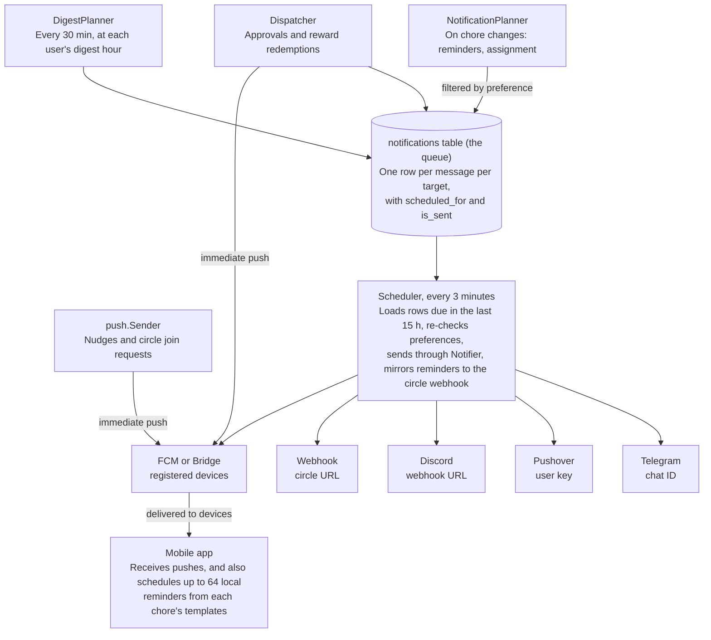

# Notifications: Overview and Design Decisions

As of 2026-11-24. Covers `lenonestrella/donetick` at `abcb7a7` and `lenonestrella/donetick-frontend` at `5664d05`.

## Summary

Donetick notifications run through one database table, `notifications`, which works as an outbound delivery queue. Code that wants to tell someone something writes a row with a `scheduled_for` time. A scheduler goroutine sends the rows that are due every 3 minutes, using the provider named on the row: Telegram, Pushover, Discord or FCM. FCM goes direct to Firebase or through Donetick Bridge on self-hosted installs.

Three producers fill the queue:

- **`NotificationPlanner`** writes chore reminders (pre-due, due, overdue) from each chore's notification templates, plus the "assigned to you" event.
- **`DigestPlanner`** writes daily and weekly summary pushes at each user's chosen local hour.
- **`Dispatcher`** handles immediate "someone is waiting on you" events (pending approval, reward redemption). It pushes to devices right away and queues rows only for the other channels.

A per-user notification profile (Balanced, Planner, Just in time, Persistent, Quiet, Custom) decides which event types fire. It is checked when a row is created and again when it is sent. Some event types need a Plus subscription.

On the frontend, users choose a channel and profile in Settings and set reminder templates on each task. The native app also schedules local device notifications.

## Architecture

Everything goes through one queue except immediate device pushes.

Three producers write rows into `notifications`, and the scheduler drains it every 3 minutes. Only immediate device pushes from `Dispatcher` and `push.Sender` skip the queue. On mobile, chore reminders are also scheduled locally by the app.

## Data model

Six stores hold notification state. Only `notifications` is written per message; the rest are configuration.

| Store | Granularity | What it holds | Defined in |
| --- | --- | --- | --- |
| `notifications` | One row per message per target | `chore_id`, `user_id`, `circle_id`, `type` (provider), `target_id`, `text`, `scheduled_for`, `is_sent`, `raw_event` (JSON with event `type` and an optional push `payload`) | `internal/notifier/model/model.go` |
| `user_notification_targets` | One per user | The user's single legacy channel: `type` (Telegram, Pushover, Discord, FCM) plus `target_id` (chat ID, user key, Discord webhook URL or FCM token) | `internal/user/model/model.go` |
| `user_device_tokens` | One per user per device | FCM token, platform, `is_active`, `last_active_at`, Bridge sync state and `bridge_device_id` | `internal/user/model/model.go` |
| `user_notification_preferences` | One per user, across all circles | `profile`, sparse `overrides` map, `digest_hour` (local 0–23) | `internal/user/model/notification_preference.go` |
| `chores.notification_meta_v2` | One per chore (JSON) | Up to 5 `templates` (`value` + unit `m`/`h`/`d`, relative to the due date) and `circleGroup` / `circleGroupID` for a Telegram group; `chores.notification` is the on/off switch | `internal/chore/model/model.go` |
| `circles.webhook_url` | One per circle | Where reminder events are mirrored as signed HTTP webhooks | `internal/circle/model/model.go` |

A template's sign sets its event type: a negative value is `pre_due`, zero is `due`, and a positive value is `overdue`. For example, `-1 h` fires an hour before the due time.

Digest rows store a negative sentinel in `chore_id`: -1 for daily and -2 for weekly. That lets them share the queue without colliding with real chore IDs. It also lets the send query skip the circle webhook for them.

The migrations show how this evolved: `chat_id` moved into `user_notification_targets` (Dec 2024), notification metadata v2 (Apr 2025), and the fixed flags (`dueDate`, `predue`, `nagging`) became templates (Jun 2025). The old flags are still on the struct but the planner no longer reads them.

## Scheduling and generation

Rows are planned ahead of time and sent by polling. Nothing is sent from inside a request handler except immediate device pushes.

**Chore reminders.** `NotificationPlanner.GenerateChoreNotifications` runs after a chore is created, edited, completed, skipped or moved between projects. Creation and edit run it in a goroutine with a 30 s timeout so the HTTP response is not delayed. Each run:

1. Takes one of 64 striped mutexes keyed by chore ID, then checks `IsCurrentChore` (same `sync_version`, `updated_at`, assignee, active flag and status). A stale job exits without writing.
2. Deletes the chore's existing rows, except unsent `on_assignment` rows for the current assignee and unsent `on_pending_approval` rows for current approvers.
3. Stops if notifications are off, the chore is a `trigger` chore, or there is no next due date.
4. Builds one row per template for the assignee. A chore assigned to "Anyone" gets rows for every active member who has a target and can see the chore. Times already in the past are skipped.
5. Filters those rows by each recipient's preference. It then adds an unfiltered copy for the circle's Telegram group, unless the chore is in a private project.
6. Queues an "Assigned to you" event if the assignee changed and the actor did not assign themselves. This writes one FCM row per active device, plus the legacy target. A legacy FCM target is only used when the user has no registered devices.

**Digests.** `DigestPlanner.GenerateDueDigests` runs every 30 minutes. For each Plus user whose local hour equals `digest_hour`, it builds a daily summary (overdue plus due today) and, on Mondays, a weekly preview. Rows are push-only, one per device. Before writing, it checks for an existing sentinel row since the start of the day or week, so running twice in the hour sends once.

**Immediate events.** `dispatch.Dispatcher.NotifyUsers` handles pending approvals and reward redemptions. It filters the audience by preference, pushes to registered devices at once, and queues rows only for Telegram, Pushover, Discord, or FCM fallback. Nudges and circle join-request pushes call `push.Sender` directly. They go to devices only and skip preference checks.

**The scheduler.** `notifier.Scheduler` starts five background loops. Each runs its job and then sleeps for its interval.

| Job | Interval | What it does |
| --- | --- | --- |
| `NOTIFICATION_SCHEDULER` | 3 min | Loads unsent rows due in the last 15 h, re-checks preferences, sends each, mirrors reminder events to the circle webhook, marks rows sent |
| `NOTIFICATION_DIGEST` | 30 min | Generates daily and weekly digests |
| `BRIDGE_DEVICE_SYNC_RETRY` | 10 min | Retries Bridge registration for up to 50 devices not yet synced |
| `NOTIFICATION_CLEANUP` | 24 h | Deletes sent rows older than 10 days |
| `DEVICE_TOKEN_CLEANUP` | 24 h | Removes device registrations with no check-in for 90 days |

So a reminder can arrive up to about 3 minutes after its scheduled time.

## Delivery channels

Each row names its provider in `type`, and `Notifier.SendNotification` switches on it. A provider whose config is missing is skipped with a log line; FCM falls back from Bridge to direct Firebase.

| Provider (`type`) | `target_id` | Message used | Notes |
| --- | --- | --- | --- |
| Telegram (1) | Chat ID, user or group | `text`, Markdown | One bot token per instance; also used for circle group reminders |
| Pushover (2) | User key | `text`, title "Donetick" | One app token per instance |
| Discord (4) | Webhook URL | `text` | URL is checked against the webhook security policy when saved |
| FCM (5) | Device token | `raw_event.payload` title, body and data; falls back to `text` | Bridge when connected and enabled, otherwise direct Firebase Admin SDK; none configured means skip |
| Webhook (3) | — | — | Not implemented as a provider; see below |

**Circle webhooks** sit beside the providers rather than among them. When the scheduler sends a reminder row and the circle has a `webhook_url`, it also publishes a `task.reminder` event to it. The send query hides the URL for digest rows and for chores in private projects. The `EventsProducer` posts from a bounded in-memory queue and drops events when it is full. Each URL is re-validated, rate limited, and optionally HMAC-signed.

**Donetick Bridge** lets a self-hosted instance push to the official mobile apps without its own Firebase project. Core registers each device with Bridge and stores the returned `bridge_device_id`; failed registrations are retried every 10 minutes. Sends carry an idempotency key built from the row ID and `scheduled_for`. That way a retried row does not use up the owner's monthly Bridge quota twice. Multicast sends through Bridge are capped at 20 devices per request.

**Dead tokens** are pruned on the way back. With direct FCM, `UNREGISTERED` and `SENDER_ID_MISMATCH` deactivate the token. With Bridge, an `invalid_token` status does the same. Transient errors such as quota or timeouts leave the token alone.

## Frontend

The frontend has three places to configure notifications. On native builds it is also a second delivery path for chore reminders.

| Where | File | What the user sets |
| --- | --- | --- |
| Settings → Notifications | `views/Settings/NotificationSetting.jsx` | Device switch (OS permission plus push registration), profile picker, per-event fine-tune toggles saved as sparse overrides, digest hour. Plus-only profiles and events open the paywall for free users. |
| Settings → Notification integrations | `views/Settings/NotificationIntegrationsSettings.jsx` | The one legacy target: Telegram chat ID, Pushover user key, or "Webhooks" (type 3) |
| Task editor | `components/NotificationTemplate.jsx` | Up to 5 reminder offsets, with suggestions such as 1 day, 3 hours or 30 minutes before, and 1, 3 or 7 days after |

**Local reminders on the device.** `useLocalNotificationSync` re-plans whenever the chore list or preferences change. It cancels every pending local notification, then rebuilds them from each chore's templates using the same offset arithmetic as the server. It keeps only chores meant for this user and event types the profile allows. It schedules the soonest 64 (the Android limit) through Capacitor `LocalNotifications`.

The server-resolved `effective` event map is cached in Capacitor Preferences. An offline cold start still honours the last known profile; with no cache at all it schedules everything.

Notification IDs are a murmurhash of chore ID, value and unit. So the same reminder keeps the same ID across re-plans.

**Push registration.** `CapacitorListener.js` registers the FCM token with the server on each launch. The device ID, token, platform and app version are cached so unchanged registrations are not resent. When nothing changed, an activity ping still refreshes `last_active_at` so the 90-day cleanup does not remove the device.

On the official Donetick instance the device switch turns on both local reminders and server push. On other instances it controls local reminders only. The local permission is the master switch: if push fails or is declined, local reminders keep working.

## Key design decisions

The system prefers simple, self-hostable parts and fails open on delivery but closed on privacy. The rationale below comes from code comments and the shape of the code; no separate design record was found in either repo.

| # | Decision | Why | Cost |
| --- | --- | --- | --- |
| 1 | **A database table as the delivery queue**, drained by a 3-minute polling loop | No broker or extra service; survives restarts; same code on SQLite and Postgres | Up to ~3 min latency; one process does all sending |
| 2 | **Plan ahead, then replace.** Every chore change deletes that chore's future rows and regenerates them | No diffing logic; the queue always matches the current chore | Extra writes on every edit; pending assignment and approval rows need special cases to survive |
| 3 | **Per-chore serialization and a revision check** (64 striped mutexes plus `IsCurrentChore`) | Planning runs asynchronously, so an older job must never overwrite a newer plan or notify a replaced assignee | Locks are in-process, so this only holds with a single server instance |
| 4 | **Reminders as offsets from the due date** (up to 5 per chore; the sign gives the event type) | One model covers before, at and after due; replaced the fixed `dueDate`/`predue`/`nagging` flags | Offsets are relative to `next_due_date` only; no absolute times |
| 5 | **One provider per row**, chosen when the row is written | The sender stays a simple switch; each provider gets its own message shape (`text` vs push `payload`) | One logical reminder can become several rows |
| 6 | **Two kinds of destination:** one legacy target per user, plus many registered devices. A legacy FCM target is used only if the user has no devices | Old installs keep working; mobile users get every device; no double pushes | Two code paths that `Dispatcher`, the planner and digests must each keep in step |
| 7 | **Profiles plus sparse overrides**, per user and not per circle | Switching profile is one field change; overrides keep only real deviations | A client that posts a full map would mask every default, so the server re-sparsifies overrides on save |
| 8 | **Preferences checked twice**: when a row is created and again when it is sent | A quieter profile applies at once to reminders already queued | An extra preference query on every scheduler run |
| 9 | **Fail open on delivery errors.** If preferences cannot load, send anyway; unknown event types are always allowed | Losing a reminder is judged worse than ignoring a profile briefly | Muted users may occasionally get a message |
| 10 | **Fail closed on visibility.** `CanReceiveChore` is the one rule for who may see a chore's name; an unloaded project counts as private | Private projects must never leak through reminders, group chats or webhooks | Callers must load the project or no one is notified |
| 11 | **Plus gating decided at read time** (`IsPlus` loaded live) and also on save (`DowngradeToFree`) | A lapsed subscription stops costly event types without rewriting rows | Gating logic exists in both backend and frontend |
| 12 | **Immediate events push now and queue the rest** (`Dispatcher`) | Approvals and redemptions are time-sensitive; one shared fan-out replaced several hand-rolled ones that each got some rule wrong | Device pushes are not retried if they fail |
| 13 | **Bridge preferred over direct FCM**, with an idempotency key from row ID and time | Self-hosted users get push to the official apps without a Firebase project; retries do not spend quota twice | An extra external dependency and registration state per device |
| 14 | **Digests are push-only and deduped by sentinel rows** | A personal summary does not fit per-chore channels; a 30-minute job can safely run twice in the send hour | Users without a registered device get no digest |
| 15 | **Chore reminders on mobile are scheduled on the device** | Works offline; no server push cost; respects the cached profile | Reminders reflect the chore list as of the last app open |
| 16 | **Webhooks are best-effort**: an in-memory queue that drops when full, URL safety re-checked, optional HMAC signature | Webhooks must never slow down requests or become an SSRF vector | Events are lost on restart or overflow |
| 17 | **Sent rows kept for 10 days only** | The table is a delivery queue, not a history | No long-term audit of what was sent |

## Known limitations and open questions

The most serious finding is that failed sends are not retried, even though the code comments say they are.

- **Failed sends are marked sent.** In `scheduler.go`, a failed row is skipped with `continue` and keeps `IsSent = false`. But `MarkNotificationsAsSent` (`internal/notifier/repo/repository.go:74`) updates every loaded row by ID and ignores that flag. So provider errors, Bridge quota errors and "device not yet registered with bridge" are all dropped. The comments in `notifier.go` and `bridgenotifier.go` describe a retry that does not happen. The fix is to pass only rows with `IsSent == true`.
- **Rows older than 15 h are never sent or cleaned up.** The send query looks back 15 hours, and cleanup deletes only sent rows. If the server is down longer than that, those reminders are skipped silently and stay in the table forever.
- **"Webhooks" (type 3) has no sender.** The integrations screen offers it, but `Notifier` does nothing for that type and the row is marked sent. Delivery then happens only if the circle has a `webhook_url`.
- **Discord is backend-only.** The backend sends to Discord (type 4), but the integrations screen does not offer it.
- **Nudges and circle join pushes skip preferences.** They call `push.Sender` directly. They reach registered devices only, not the legacy target.
- **Completion notifications are off.** The `SendChoreCompletion` call is commented out in the complete handler, and the `completion` flag is unused.
- **Single-instance assumption.** Planning locks and the webhook queue live in process memory. Running two backend replicas could race plans and send duplicates.
- **Mobile reminders can go stale.** Local reminders are rebuilt only while the app runs. A chore assigned or rescheduled on the web reaches a phone's reminder plan only after the app next opens. Web-only users get reminders only through a legacy target.
- **Open question:** should chore reminders also be pushed from the server to registered devices? Today they go only to the legacy target and to the device's local schedule.
